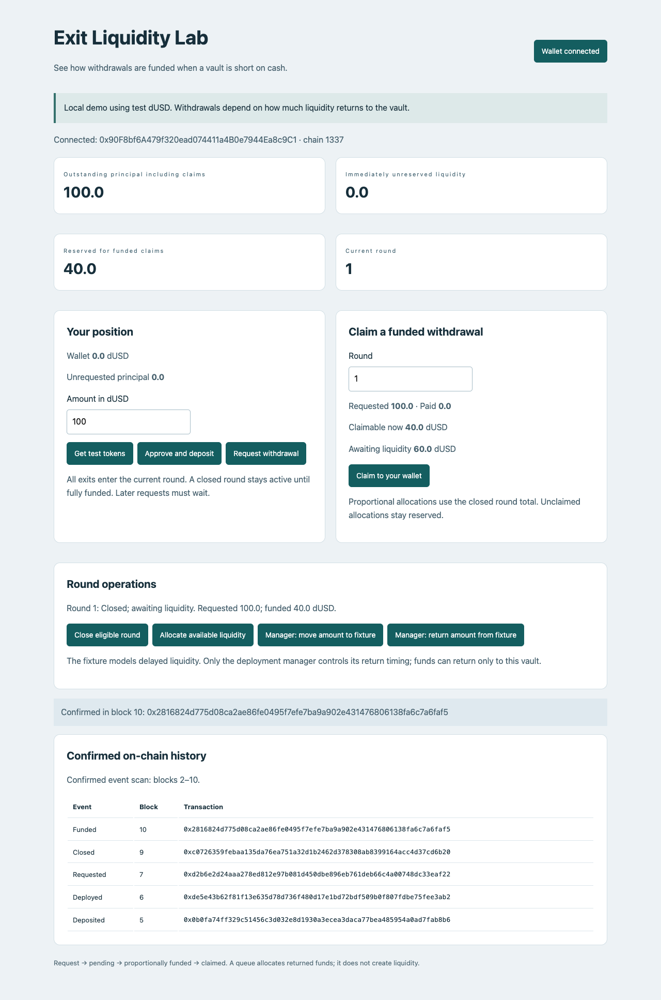

# Exit Liquidity Lab

What happens when three people want to withdraw 500 tokens and a vault can return only 200? This project compares two ways to handle that shortage and implements one of them in Solidity.

Suppose the requests arrive in the order 100, 150, then 250. The first 200 tokens would be distributed like this:

| Policy | 100-token request | 150-token request | 250-token request |
| --- | ---: | ---: | ---: |
| First in, first out | 100 | 100 | 0 |
| Proportional within the round | 40 | 60 | 100 |

FIFO finishes one withdrawal immediately. With proportional funding, everyone gets 40% of their request and everyone still has money waiting. The vault uses the proportional rule. The [benchmark](evidence/benchmark.json) puts both policies through the same sequence of liquidity returns.



## How withdrawals work

Users deposit a six-decimal test token and request a withdrawal during an open round. Once the round closes, the contract uses the original requests and total funding received to calculate each person’s share. Users can claim the funded portion while the rest waits. The next round opens once the current requests are fully funded, even if some users have yet to collect their reserved tokens.

The demo's liquidity fixture lets a manager control when tokens come back. It can return funds only to the vault, and the manager can delay a return indefinitely. A round that stays underfunded also delays later requests. The vault tracks principal only, using a test token and simulated liquidity returns.

The [technical report](report.pdf) explains the allocation math, how rounding works across installments, and where the design runs out of room.

## Run it locally

Use Node.js 22 or 24. From the repo folder:

```sh
npm ci
npm run compile
```

Start the local chain in one terminal:

```sh
npm run chain
```

In another terminal, deploy the contracts and start the web app:

```sh
npm run deploy
npm start
```

Open <http://127.0.0.1:3000>. Connect MetaMask to the local RPC at `http://127.0.0.1:18545`, chain ID `1337`. Use a disposable wallet with a local Ganache account.

To see a partial withdrawal, mint and deposit 100 test dUSD with the deployer account. Move 60 to the fixture, request 100, and wait for the round to close. Close and settle it, then claim the 40 already available. Return the other 60 from the fixture, settle again, and claim the rest.

## Tests and evidence

Run `npm run check:all` to compile the contracts, run the regression and stress suites, and reproduce the synthetic comparison. The [recorded stress run](evidence/stress.json) covers 480 state transitions and a 32-user case funded in 17 installments. The [browser test](test/browser-qa.cjs) uses an injected wallet against the local chain and backend. MetaMask extension and Sepolia testing are still open.

- [Contract](contracts/ExitVault.sol) handles round timing, allocation, and claims.
- [Node server](server.mjs) reads vault state and confirmed events. The wallet signs transactions.
- [Verification notes](VERIFICATION.md) cover test scope and dependency findings.
